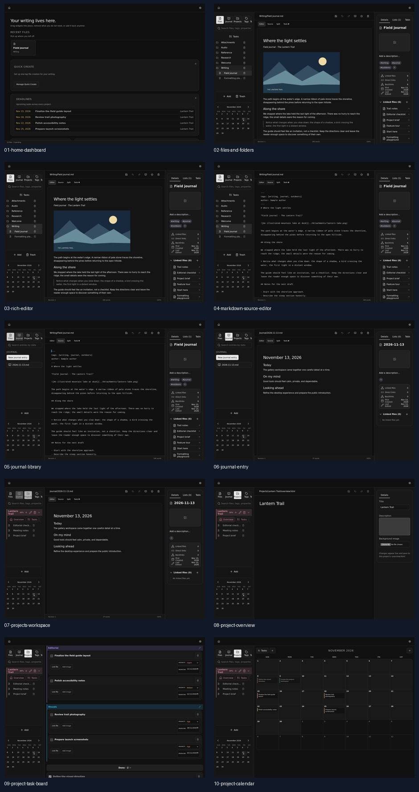
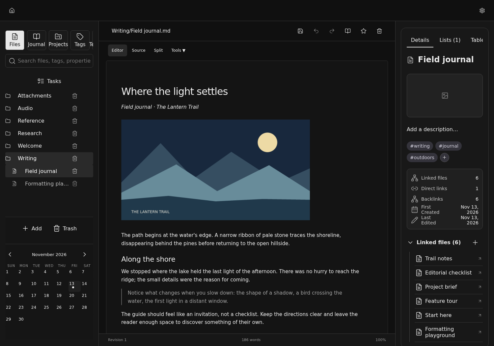
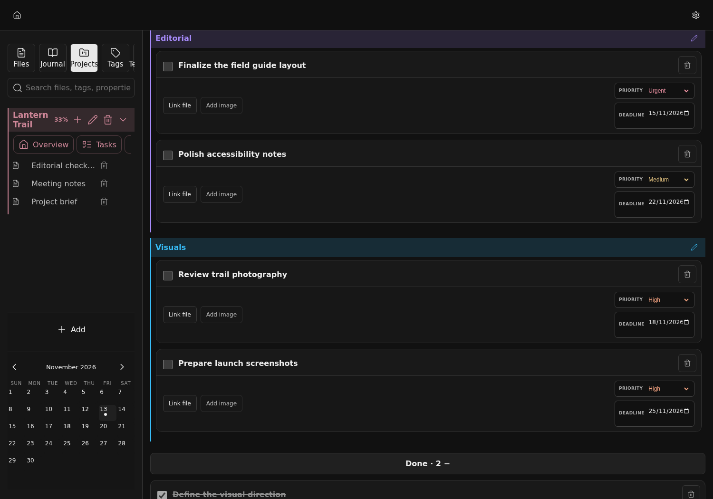
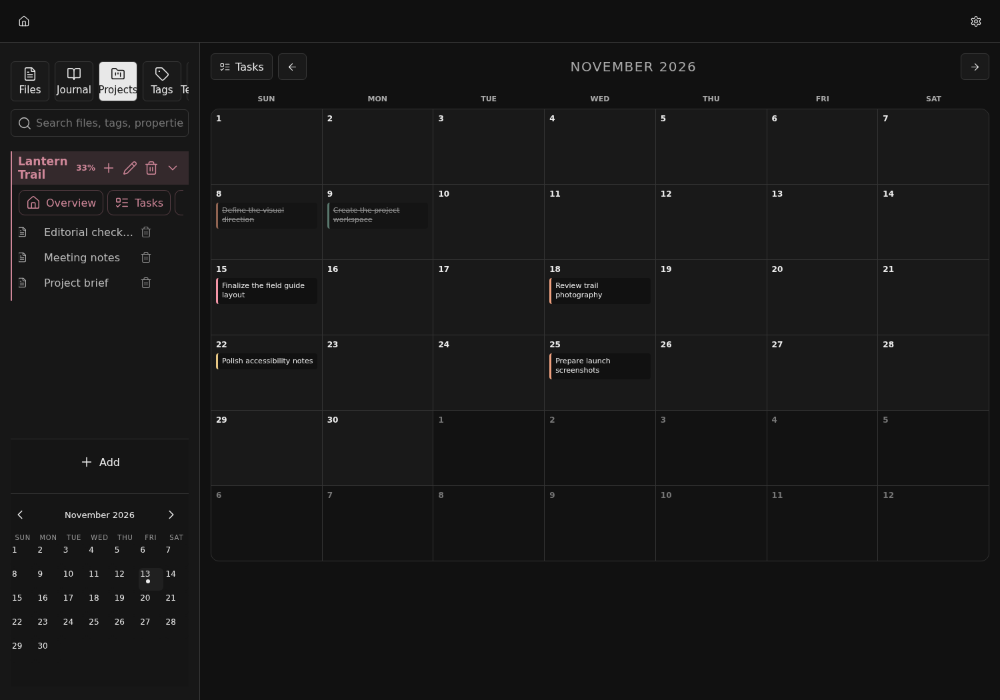

# Spire

Spire is a private writing and project workspace built for people who want their notes, journals, research, media, and project work in one organized place.

It combines a focused document editor with folders, journals, project boards, deadlines, calendars, and visual galleries. Instead of piecing together a writing app, task manager, and file browser, you can keep the work and the context around it together.

> Spire is currently in private development. This repository is the public home for product information and future release news; the application source is not published here.

## What you can do in Spire

### Write without losing the structure around your work

Create ordinary files and folders, then write in a rich editor or edit the Markdown source directly. Spire keeps the file path visible and gives each document its own context for details, links, media, properties, revisions, and writing tools.

Examples:

- Draft a story in `Writing/Chapter 4.md`
- Keep research notes beside the draft
- Add images, audio, tables, lists, definitions, and file links
- Switch between rich editing, Markdown source, and split views
- Review earlier revisions when a document changes

### Keep a real journal

The Journal section keeps dated entries separate from ordinary files while still giving them the full editor. A calendar makes it easy to move through past entries or start a new page for today.

You might use it for daily reflections, work logs, travel notes, creative fragments, or a running record of a long project.

### Turn a folder into a working project

Projects have their own space without taking over the normal file browser. Each project can include supporting documents, an overview, grouped tasks, deadlines, a task calendar, and a media gallery.

For example, a publishing project could contain:

- A project brief and meeting notes
- An editorial checklist
- Tasks grouped under Writing, Editorial, and Visuals
- Due dates and priorities
- Completed work kept out of the active task groups
- Reference images gathered in the project gallery

### See deadlines on a calendar

Tasks with due dates appear in the project calendar and on the Home dashboard. This keeps the schedule connected to the actual project instead of hiding it in a separate planner.

### Start from Home

The Home screen is a personal dashboard for getting back into the workspace quickly. It can show recent files, upcoming deadlines, a new journal entry, quick notes, quick audio, and saved creation shortcuts. Widgets can be rearranged or removed to fit the way you work.

### Organize more than documents

Spire also includes dedicated workspace sections for:

- Tags
- Templates
- Sources and research material
- Images, audio, and other attachments
- Linked files and backlinks
- File properties and descriptions
- Bookmarks
- Dictation and transcripts
- Revision history
- Sync conflicts when they need attention

## A simple example

Imagine you are planning a field guide called *Lantern Trail*.

1. Put the early research in `Research/Trail notes.md`.
2. Draft the guide in the rich editor and keep the original Markdown available whenever you need it.
3. Create a Lantern Trail project for the brief, meeting notes, and editorial checklist.
4. Group tasks by editorial and visual work, then assign priorities and due dates.
5. Review the schedule in the project calendar.
6. Keep reference photography in the gallery and daily thoughts in the Journal.
7. Return to Home to see the next deadline and reopen the latest draft.

The files remain understandable as files. The project tools add structure around them rather than turning every note into a task or database record.

## Privacy and ownership

Spire is focused on private, self-hosted workspaces. You choose where it runs and keep control of your files, without relying on a third-party cloud or paying for a service that stores your work on someone else's server.

## Platforms

Spire is currently web-based and Docker-optimized, with dedicated client support planned for:

- Android
- Windows
- Linux

## Project status

Spire is currently in development, with more features planned for future releases.
