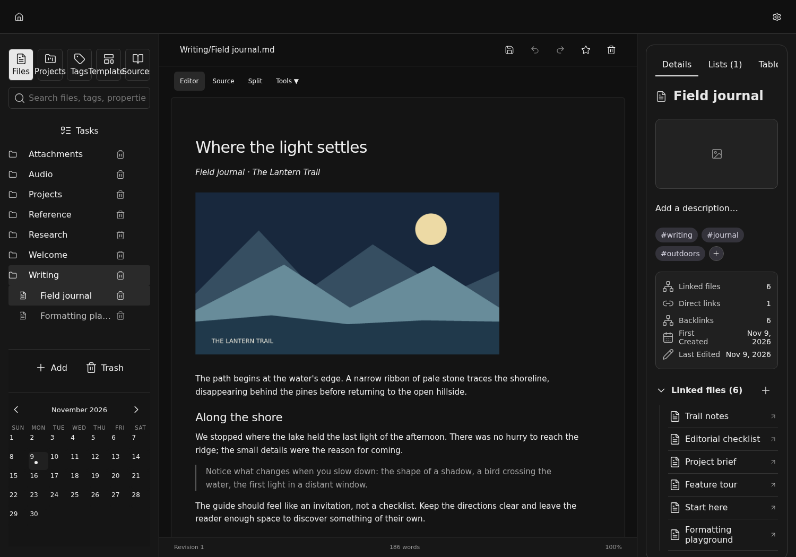
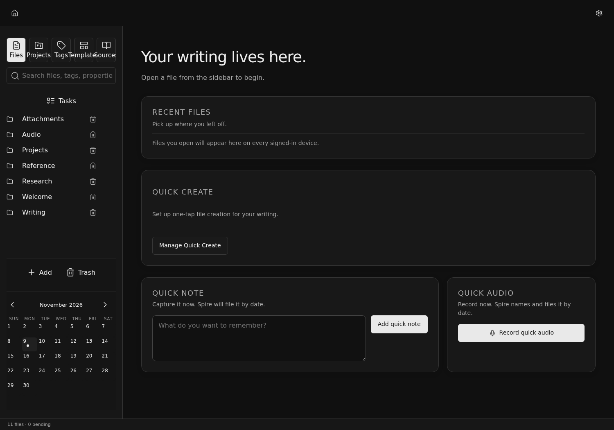
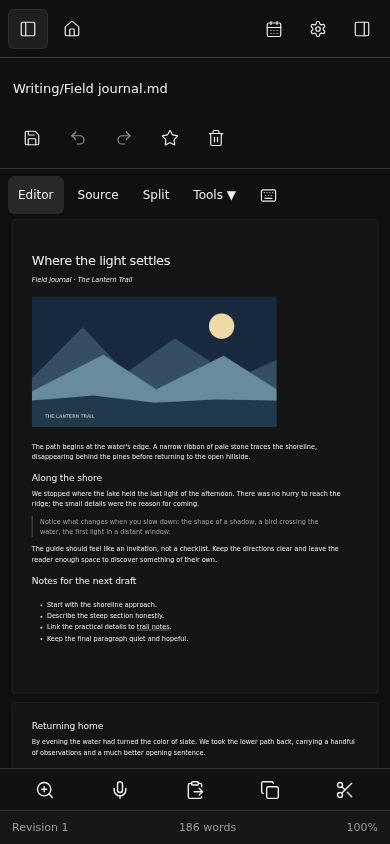
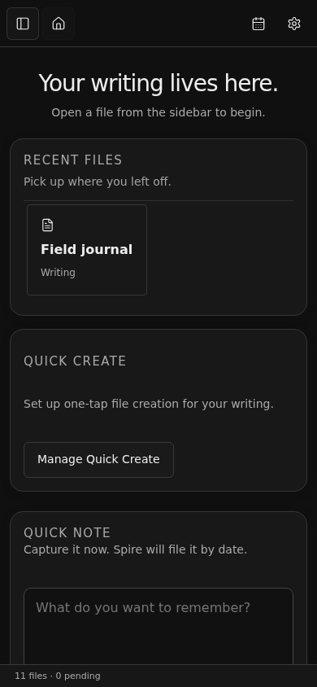

# Spire

**A self-hosted workspace for writing, research, and projects.**

Write in a visual editor or work directly in Markdown. Keep notes, images, audio, references, and project plans together—without turning your files into a proprietary format.

Spire calls your collection of files and attachments a **Reliquary**. Documents live in folders; projects have their own space under `Projects/`.

> **Preview software.** Spire is under active development. Back up your data before upgrades. This is currently a single-owner application, not a multi-user collaboration service.

## Screenshots

Screenshots use fictional demonstration content. No personal workspace or private server appears in these captures.

### Desktop





### Mobile




## Main features

### Writing and editing

- Visual **Editor**, Markdown **Source**, and explicit **Split** views.
- Headings, lists, checklists, quotes, code blocks, links, tables, and highlighting.
- Formatting tools that stay collapsed until needed, plus keyboard and editing controls.
- Reusable templates, quick-create actions, and a block chooser.
- Document zoom, word counts, page layout, table of contents, and running headers/footers.
- File-specific CSS for presentation without replacing the underlying Markdown.

### Files and knowledge

- Folder-based organization, import, renaming, favorites, and trash.
- Recent files, quick notes, and quick audio capture from Home.
- Wiki links, ordinary links, backlinks, linked files, tags, and YAML properties.
- Definitions, research sources, and citations.
- Document-derived lists and tables in the Context panel.
- File maps and relationship views for exploring connected material.

### Projects and collections

- A dedicated Projects area, separate from the ordinary Files tree.
- Project overviews and task boards with file associations.
- Link a task to an existing file or create a new file for it; unlinking keeps the file.
- Task and gallery collections scoped to the workspace or a project.
- Image tags, including tagging directly from image options in project documents.

### Images, audio, and video

- Embedded attachments with portable Markdown/HTML references.
- Image preparation, percentage sizing, alignment, and inline/block/wrapped text flow.
- Centered image options with accessible width, layout, and deletion controls.
- Audio recording, attachment playback, and audio-note views.
- Video attachment playback and capture controls where the browser supports them.
- Voice authoring and transcription features; availability depends on browser permissions, platform capabilities, and configured voice assets.

### History and safe saving

- Server-confirmed saves and revision-aware writes.
- Revision history with changes, preview, source, comparison, and restoration.
- Conflict detection and recovery controls rather than silent overwrites.
- Opened-content reuse and background Recent Files tracking to avoid unnecessary waits.

### Responsive workspace

- Desktop side panels with draggable widths and snap-to-default behavior.
- Context controls appear only where relevant to the active file or project.
- Mobile drawers, touch-friendly controls, and a full-width file path above the action row.
- Home cards adapt to the available width.
- Sidebar calendar on desktop, with a calendar entry point on mobile.

## Installation

Choose the guide for your system:

- [Docker installation](documents/installation/docker.md)
- [Windows installation](documents/installation/windows.md)
- [Linux installation](documents/installation/linux.md)

The current release runs as a web application. Docker is the recommended installation method, including on Windows and Linux. Dedicated Windows and Linux clients are planned for future releases.

## Development

Requires Node.js **22.12 or newer**.

```sh
npm ci
npm test
npm run build
npm start
```

The built app is served on `http://localhost:4173` by default. Browser checks:

```sh
npm run test:browser
```

Voice assets are prepared by the build workflow; see `scripts/prepare-voice-assets.mjs` and `documents/voice-assets.lock.json` for downloads and their pinned metadata. Some browser, voice, and native-platform capabilities need separate validation on the intended device.

## Source layout

- `client/`: web interface and editor UI.
- `server/`: authentication, storage, revisions, and APIs.
- `shared/`: shared formats and data rules.
- `tests/`: automated tests and browser scenarios.
- `documents/`: installation and technical documentation.

The responsive web app is the current Spire client. See [source layout](documents/source-layout.md) for implementation details.

## Privacy and ownership

Spire is focused on private, self-hosted workspaces. You choose where it runs and keep control of your files, without relying on a third-party cloud or paying for a service that stores your work on someone else's server.

## Platforms

Spire is currently web-based and Docker-optimized, with dedicated client support planned for:

- Android
- Windows
- Linux

## Project status

Spire is currently in development, with more features planned for future releases.

## License and credits

Spire is licensed under the [Apache License 2.0](LICENSE). See [Credits and third-party software](CREDITS.md) for the open-source projects, bundled components, and development tools used by Spire.
