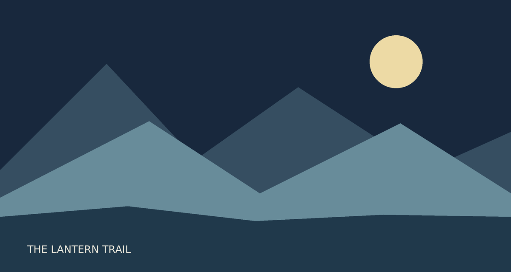

# The Lantern Trail

**A short illustrated guide to a fictional place.**

## The idea

Create a welcoming reading experience that combines a field journal, a clear route outline, and a small set of illustrations.

## What belongs here

- An opening essay with a calm, observant voice.
- Practical notes arranged in a readable table.
- A gallery of visual references tagged by purpose.
- A short editorial checklist linked to the working files.

## Visual references

Tap either image to explore sizing and gallery tags. Open the project's Gallery to browse the same illustrations by tag.

## Related work

- [[Writing/Field journal|Field journal]]
- [[Research/Trail notes|Research notes]]
- [[Projects/Lantern Trail/Editorial checklist|Editorial checklist]]
